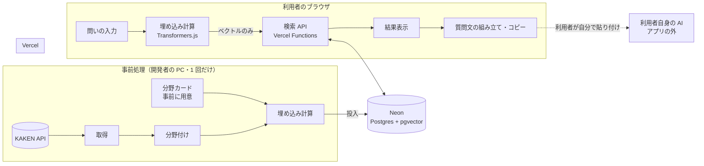
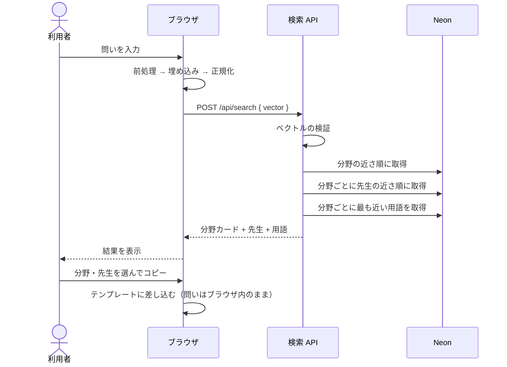

# 設計書

[仕様書](SPEC.md) を実現するための設計。数値（次元数・件数・しきい値）は技術検証の結果で見直す。

## 1. 全体構成

画面と検索 API を Vercel に置き、データは Neon（Postgres + pgvector）に入れる。問いの文章はブラウザの中でベクトルに変え、サーバーにはベクトルだけを送る。



アプリの中で AI が動くのは「埋め込み計算」だけ。事前処理とブラウザで**同じモデル・同じ前処理**を使うことが、この設計の前提になる。

## 2. 技術スタック

| 層 | 技術 |
| --- | --- |
| 画面 | Next.js（App Router・React・TypeScript） |
| サーバー | Vercel Functions（Next.js の Route Handler） |
| DB | Neon（Postgres + pgvector） |
| アプリ内の AI | Transformers.js + 日本語の埋め込みモデル（ブラウザで実行） |
| データの準備 | Python（KAKEN API から取得、分野付け、埋め込み計算） |
| 開発 | GitHub（Issue・PR）、GitHub Actions |

## 3. 処理の流れ



問いの文章は「質問文の組み立て」でだけ使い、その処理もブラウザ内で完結する。

## 4. 埋め込みモデル

| 候補 | 次元数 | 確認すること |
| --- | --- | --- |
| [Ruri v3 30m](https://huggingface.co/cl-nagoya/ruri-v3-30m) | 256 | Transformers.js で動く ONNX 版があるか、なければ自分で変換できるか |
| [multilingual-e5-small](https://huggingface.co/Xenova/multilingual-e5-small) | 384 | 日本語の問いと研究課題の結びつきの精度 |

- どちらも、検索する側とされる側で決まった接頭辞を付ける（Ruri：`検索クエリ: ` / `検索文書: `、e5：`query: ` / `passage: `）。接頭辞と正規化のルールは `shared/embedding.json` のような設定ファイル 1 つにまとめ、Python と TypeScript の両方から読む。
- ベクトルは L2 正規化して保存・送信する。近さはコサイン類似度（pgvector の `<=>` 演算子）で測る。
- モデルファイルは自前で配信する（`public/models/` など）。外部 CDN に頼らず、CSP の許可先も絞れる。
- WebGPU が使えれば WebGPU、なければ WASM で動かす。どちらでも動かない端末向けに、同じモデルをサーバーで動かす保険を用意する（発表用 PC 対策）。
- スマートフォンでは WASM で動くことが多く、メモリも少ない。量子化版（q8 など）を使ってダウンロードとメモリを抑え、モデルの選定ではスマートフォンでの速度も比べる。読み込みに失敗したり遅すぎたりする端末では、上のサーバーの保険に切り替える。

## 5. データ準備（事前処理）

Python のスクリプトで、次の順に処理する。結果は DB に投入し、中間ファイルは `data/` に置く。

1. **取得**：KAKEN API から対象大学の研究課題を取得し、JSON で保存する。取得は 1 回だけ行い、チームで共有する。1 回の取得件数を多めにし、リクエストの間隔を空ける。
2. **研究者の整理**：研究課題を研究者ごとにまとめ、研究テーマの文章（課題名 + キーワード + 概要）を作る。
3. **分野付け**：KAKEN の審査区分・研究分野を、デモで扱う約 30 分野に対応表で割り当てる。LLM は使わず、対応表（`data/field_map.csv`）による手続きで行う。
4. **分野カードの読み込み**：事前に用意した分野カード（`data/fields.yaml`）を読み込む。
5. **埋め込み計算**：研究テーマ・分野の説明・用語をそれぞれベクトルにする。
6. **投入**：DB に書き込む。

分野カードの形式（例）：

```yaml
- id: philosophy
  name: 哲学
  summary: 当たり前を根っこから問い直す学問
  misconception: 答えの出ない空論
  terms:
    - term: 他者論
      description: 自分とは異なる心を持つ他者を、どう理解できるかを問う
    - term: 現象学
      description: 経験がどのように現れるかを、その現れのままに記述する
```


## 6. DB スキーマ

次元数はモデルで決まる（例は Ruri v3 30m の 256 次元）。

```sql
create extension if not exists vector;

-- 分野カード
create table fields (
  id            text primary key,          -- 'philosophy'
  name          text not null,
  summary       text not null,
  misconception text not null,
  embedding     vector(256) not null       -- name + summary + 用語から作る
);

-- 分野ごとの専門用語（「あなたの問いの、この分野での呼び名」）
create table terms (
  id          serial primary key,
  field_id    text not null references fields(id),
  term        text not null,
  description text not null,
  embedding   vector(256) not null
);

-- 先生（KAKEN の研究者）
create table researchers (
  id          text primary key,            -- KAKEN の研究者番号
  name        text not null,
  affiliation text not null,               -- 学部・学科
  theme       text not null,               -- 画面に出す研究テーマ
  kaken_url   text not null,
  embedding   vector(256) not null
);

-- 先生と分野の対応（1 人が複数分野に属することがある）
create table researcher_fields (
  researcher_id text not null references researchers(id),
  field_id      text not null references fields(id),
  primary key (researcher_id, field_id)
);
```

デモの規模（立命館大学のみ・数千件）なら全件の総当たりで十分速いので、ベクトル索引（HNSW など）は作らない。遅ければ追加する。

## 7. 検索 API

### `POST /api/search`

リクエスト：

```json
{ "vector": [0.0123, -0.0456, "…（次元数ぶん）"] }
```

レスポンス：

```json
{
  "fields": [
    {
      "id": "philosophy",
      "name": "哲学",
      "summary": "当たり前を根っこから問い直す学問",
      "misconception": "答えの出ない空論",
      "score": 0.82,
      "term": { "term": "他者論", "description": "…" },
      "researchers": [
        {
          "id": "12345678",
          "name": "○○",
          "affiliation": "文学部",
          "theme": "現象学",
          "kakenUrl": "https://nrid.nii.ac.jp/…",
          "score": 0.76
        }
      ]
    }
  ]
}
```

### 分野の選び方

1. 全分野を、問いのベクトルとの近さで並べる。
2. 上位 3 分野を選ぶ（一致度の高い分野）。
3. 残りの 2 枠は、4〜10 位から「上位 3 分野と互いに似ていない」分野を選ぶ（「わざと隣の分野も見せる」、仕様 F-6）。分野どうしの似ていなさは分野ベクトルどうしの距離で測る。
4. 各分野で、問いに最も近い用語を 1 つ、最も近い先生を最大 3 人取る。

### 入力の検証

- `vector` が数値の配列で、長さが次元数と一致し、すべて有限の数であること。
- ノルムが 1 に近いこと（正規化済みであること）。
- 違反したら 400 を返す。リクエスト本文の上限は 16KB。

## 8. 画面の構成

```
app/
  page.tsx                 # 問いの入力
  result/page.tsx          # 見渡す・出会う
  about/page.tsx           # このアプリについて
  api/search/route.ts      # 検索 API
components/
  QuestionInput.tsx
  FieldColumn.tsx          # 分野カード + 先生の一覧
  ResearcherCard.tsx
  PromptPanel.tsx          # 深める（質問文のプレビューとコピー）
  AiBadge.tsx              # 「AI」の表示
lib/
  embedder.ts              # モデルの読み込みと埋め込み計算（Web Worker で実行）
  prompt.ts                # テンプレートへの差し込み
```

- 画面はスマートフォン幅を基準に作り、PC では広げて表示する（モバイルファースト）。結果画面の分野の列は、スマートフォンでは横スワイプ、PC では横に並べる。
- 埋め込み計算は Web Worker で行い、モデルの読み込み中も画面を固まらせない。読み込みはページを開いた時点で始める（仕様 F-4a）。
- 問いの文章は React の状態としてブラウザ内に置くだけで、URL のクエリにも入れない（履歴や共有で漏れないように）。

## 9. セキュリティ設計

セキュリティは審査項目なので、対策ごとにテストし、結果を README の「セキュリティ対策」に記録する。

| 想定する攻撃・リスク | 対策 | テスト方法 |
| --- | --- | --- |
| XSS | React の自動エスケープに任せ、`dangerouslySetInnerHTML` を使わない。CSP で外部スクリプトを禁止 | 問い・DB の文字列に `<script>` などを入れて表示を確認 |
| SQL インジェクション | クエリはすべてパラメータ化する。API が受け取るのは数値の配列だけ | 不正な値を入れたリクエストを送り、400 になることを確認 |
| 不正なベクトル・過大なリクエスト | 長さ・型・ノルム・本文サイズを検証する | 長さ違い・NaN・巨大な配列を送る |
| 大量アクセス | Vercel の機能で API に回数制限をかける | 短時間に連続でリクエストを送る |
| 問いの漏えい | 問いをサーバーに送らない・URL に入れない・ログに残さない | ブラウザの開発者ツールで、通信に問いの文章が含まれないことを確認 |
| プロンプトインジェクション（質問文経由） | 質問文に差し込むのは DB の確認済みデータだけ。研究テーマ中の改行・記号を整形してから差し込む | 研究テーマに指示文を含むダミーデータで質問文を生成して確認 |
| 秘密情報の流出 | DB の接続文字列は Vercel の環境変数に置き、ブラウザに出さない | ビルド成果物に接続文字列が含まれないことを確認 |

CSP の方針：`script-src 'self' 'wasm-unsafe-eval'`（WASM の実行に必要）、`connect-src 'self'`、`worker-src 'self' blob:`。モデルを自前で配信するので外部の許可は不要。

## 10. リポジトリ構成

```
app/ components/ lib/   # Next.js（画面・検索 API）
public/models/          # 埋め込みモデル
shared/embedding.json   # 接頭辞・正規化など、Python と TS で共有する設定
data/                   # 事前処理のスクリプトと中間ファイル（Python）
docs/                   # 仕様書・設計書など
```

KAKEN から取得した生データはリポジトリに入れない（`data/` 配下の取得スクリプトで再現する）。入れるのは、アプリに必要な最小限の加工済みデータだけにする。KAKEN のデータは出典を書けば表示・加工できる（[KAKEN 利用規程](https://support.nii.ac.jp/kaken/about/terms)。文部科学省ウェブサイト利用規約、CC BY 互換）。画面には「出典: KAKEN（国立情報学研究所）https://kaken.nii.ac.jp/ ／ 加工して表示」のように出典と加工した旨を載せる。API の使い方は [KAKEN_API.md](KAKEN_API.md) を参照。

## 11. 未決事項

- [ ] 埋め込みモデル（Ruri v3 30m / multilingual-e5-small）と次元数
- [ ] 分野の選び方のパラメータ（上位何分野・隣の分野を何枠）
- [ ] KAKEN の審査区分と 30 分野の対応表
- [ ] サーバー側でモデルを動かす保険の実装方法と、切り替える条件（読み込み失敗・時間切れ）
- [x] KAKEN の生データをリポジトリに含めるか → 含めない（10 章参照。#5）
