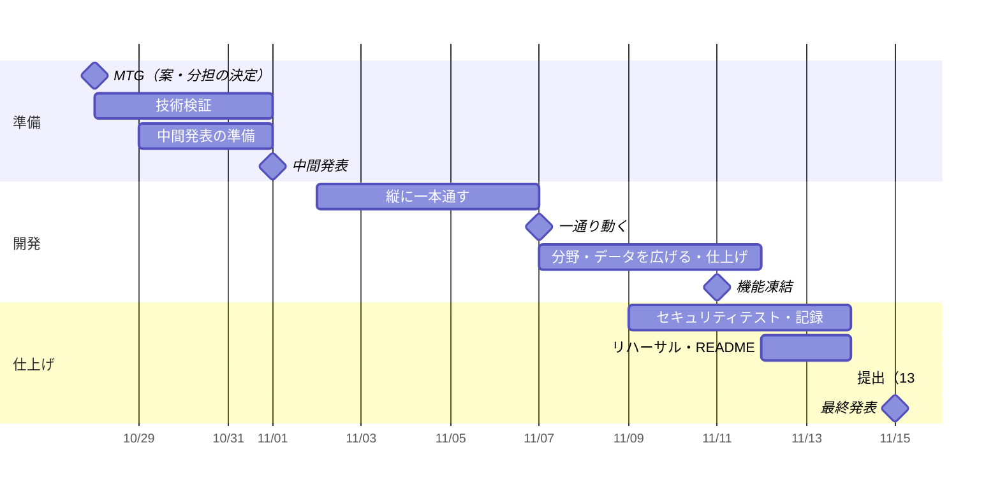

# 開発計画

[仕様書](SPEC.md)・[設計書](DESIGN.md) を 11/14 13:00 の提出までに形にするための、タスク・優先度・分担・スケジュール。担当はキックオフの自己紹介をもとにした**候補**で、10/28 の MTG で決める。

## 方針

- **最大のリスクから先に潰す。** 「小さなモデルで問いと研究課題が結びつくか」と「KAKEN API の承認」の 2 つが崩れると企画が成り立たない。どちらも中間発表（11/1）までに決着させる。
- **縦に一本通してから広げる。** まず数分野・ダミーデータで「問う → 見渡す → 出会う → 深める」が端から端まで動く状態を作り、それから分野とデータを増やす。
- **KAKEN を待たない。** 承認が下りるまでは、画面と API はダミーの先生データ（JSON）で開発する。

## 優先度

| 優先度 | 意味 |
| --- | --- |
| P0 | ないとデモが成り立たない。最優先 |
| P1 | 審査の評価に効く。P0 の後に必ずやる |
| P2 | 余裕があればやる。間に合わなければ切る |

## スケジュール

| 期日 | マイルストーン | 完了の条件 |
| --- | --- | --- |
| 10/28（水） | MTG | この案で進めるか・役割分担・デモの大学と 30 分野が決まっている |
| 11/1（日） | 中間発表 | モデルを決め、問いと研究課題が結びつくことを確かめている。スライドに背景・テーマ・開発計画・役割分担がある |
| 11/7（土） | 一通り動く | 数分野で 4 段階が端から端まで動き、Vercel 上で触れる |
| 11/11（水） | 機能凍結 | 30 分野と 1 大学分のデータが入り、P0・P1 の機能がそろっている。以降はバグ修正とテストのみ |
| 11/14（土）13:00 | 提出 | README が完成し、リポジトリ URL を提出済み |
| 11/15（日） | 最終発表 | 発表用 PC でデモが動く |

## タスク一覧

### 準備（〜11/1）

| ID | タスク | 優先度 | 担当（候補） | 期限 | 依存 |
| --- | --- | --- | --- | --- | --- |
| T-01 | KAKEN API のアプリケーション ID を申請する | P0 | 河合 | 10/28 | — |
| T-02 | researchmap API・シラバス・KAKEN データの利用規約を確かめる | P1 | 河合 | 10/31 | — |
| T-03 | 案・役割分担・デモの大学と 30 分野を決める | P0 | 全員 | 10/28 | — |
| T-04 | モデルを比較する：Ruri v3 30m と multilingual-e5-small を Transformers.js で動かし、PC とスマートフォンで読み込み時間・計算速度を測る | P0 | 高橋 | 10/31 | — |
| T-05 | 精度を確かめる：問いの例 10 個と研究課題のサンプルで、意味の近さの順位が妥当かを見る | P0 | 上原 | 10/31 | T-09 |
| T-06 | Next.js の雛形（用意済み）を Vercel と Neon につなぐ | P0 | 大澤 | 10/31 | T-S3, T-S6 |
| T-07 | 中間発表のスライドを作る | P0 | 河合 | 10/31 | T-03 |
| T-08 | 中間発表のリハーサル | P1 | 全員 | 10/31 | T-07 |
| T-09 | 精度検証の合格ラインを決める（例：問いの例 10 個のうち何個で、妥当な分野が上位 3 件に入れば合格か）。検証の前に決める | P0 | 上原 | 10/29 | T-03 |

### 案が決まったらすぐ（10/28〜10/29）

Issue・PR のテンプレートと開発環境の雛形は `chore/project-setup` ブランチに用意済み。Collaborator の招待とラベル 5 種類（feature / bug / docs / security / chore）の作成は済んでいる。残りは GitHub の設定変更や人の判断が要るもの。

| ID | タスク | 優先度 | 担当（候補） | 期限 | 依存 |
| --- | --- | --- | --- | --- | --- |
| T-S3 | `chore/project-setup` をマージする（テンプレート・開発環境の雛形） | P0 | 河合 | 10/29 | T-03 |
| T-S4 | `main` のブランチ保護（PR 必須・承認 1 人以上・CI の成功を必須に） | P0 | 河合 | 10/29 | T-S3 |
| T-S5 | このタスク一覧を GitHub Issues に登録する | P0 | 河合 | 10/29 | T-03 |
| T-S6 | Vercel・Neon をどのアカウントに置くかを決める。Vercel の無料プラン（Hobby）は非公開リポジトリでの共同開発に対応しておらず、オーナー以外のコミットはデプロイされない。リポジトリを公開にするか、オーナーのコミットだけでデプロイするか、有料プランにするかを選ぶ。無料枠と、超えたときの費用も確かめる | P0 | 大澤 | 10/29 | T-03 |

### 開発（11/2〜11/11）

| ID | タスク | 優先度 | 担当（候補） | 期限 | 依存 |
| --- | --- | --- | --- | --- | --- |
| T-10 | ダミーの先生データ（JSON）を作る | P0 | 上原 | 11/2 | — |
| T-11 | 埋め込みの共有設定（`shared/embedding.json`）と、ブラウザの埋め込み処理（Web Worker） | P0 | 高橋 | 11/4 | T-04 |
| T-12 | 検索 API（分野・用語・先生の取得、隣の分野の選び方） | P0 | 大澤 | 11/6 | T-06 |
| T-13 | 画面：問いの入力（読み込み中も入力できる） | P0 | 高橋 | 11/5 | T-11 |
| T-14 | 画面：結果（分野カード・先生、スマートフォンでは横スワイプ） | P0 | 高橋 | 11/7 | T-12 |
| T-15 | 画面：深める（質問文の組み立て・コピー） | P0 | 河合 | 11/7 | T-14 |
| T-16 | KAKEN から 1 大学分を取得し、研究者ごとに整理する | P0 | 上原 | 11/6 | T-01, T-03 |
| T-17 | KAKEN の審査区分と 30 分野の対応表を作り、分野付けする | P0 | 上原 | 11/7 | T-16 |
| T-18 | 埋め込みを計算し、DB に投入する | P0 | 上原 | 11/9 | T-11, T-17 |
| T-19 | 分野カード 30 分野を作り、互いに確認する（各自の専攻に近い分野を担当） | P0 | 全員 | 11/9 | T-03 |
| T-20 | 「AI」表示と「アプリの外」表示 | P1 | 高橋 | 11/10 | T-14 |
| T-21 | 「このアプリについて」画面（AI の場所・問いを保存しないこと・出典） | P1 | 河合 | 11/10 | — |
| T-22 | サーバーでモデルを動かす保険と、切り替えの条件 | P1 | 大澤 | 11/11 | T-12 |
| T-23 | シラバス・蔵書との連携 | P2 | 未定 | 11/11 | T-02 |

### セキュリティ・仕上げ（11/9〜11/15）

| ID | タスク | 優先度 | 担当（候補） | 期限 | 依存 |
| --- | --- | --- | --- | --- | --- |
| T-30 | 入力の検証（ベクトルの長さ・型・ノルム・本文サイズ） | P0 | 大澤 | 11/9 | T-12 |
| T-31 | CSP・回数制限・環境変数の確認 | P1 | 大澤 | 11/10 | T-06 |
| T-32 | セキュリティテストを行い、README に記録する | P1 | 大澤 | 11/12 | T-30, T-31 |
| T-33 | 問いが通信に含まれないことを確かめ、デモ用に見せ方を用意する | P1 | 大澤 | 11/12 | T-13 |
| T-34 | README の仕上げ（機能の状態・セットアップ・役割分担） | P0 | 河合 | 11/13 | — |
| T-35 | 最終発表のスライドとデモの台本 | P0 | 河合 | 11/13 | — |
| T-36 | リハーサル（発表用 PC・スマートフォンの両方でデモを通す） | P0 | 全員 | 11/13 | T-35 |
| T-37 | 提出（Google Form にリポジトリ URL） | P0 | 河合 | 11/14 13:00 | T-34 |
| T-38 | 発表用 PC の接続確認と、モデルの事前読み込み | P0 | 発表者 | 11/15 | T-36 |

## 分担の見通し（候補）

| 担当（候補） | 主なタスク |
| --- | --- |
| 河合 | 進捗管理、KAKEN 申請、スライド・README・提出、深める画面 |
| 上原さん | データ準備（KAKEN の取得・分野付け・埋め込み・投入）、精度の検証 |
| 高橋さん | 画面、ブラウザの埋め込み処理、モデルの比較 |
| 大澤さん | 環境構築・デプロイ、検索 API、セキュリティ対策とテスト |
| 全員 | 分野カード 30 分野、リハーサル |

上原さんの担当（T-16〜T-18）は KAKEN の承認次第で後ろにずれやすく、11/7〜11/9 に集中する。承認が遅れたら、ダミーデータで画面・API を先に完成させ、データ投入を手伝える人を回す。

## 未決事項

- [ ] 役割分担（10/28 の MTG）
- [ ] デモで扱う大学と 30 分野（10/28 の MTG）
- [ ] 最終発表の発表者
