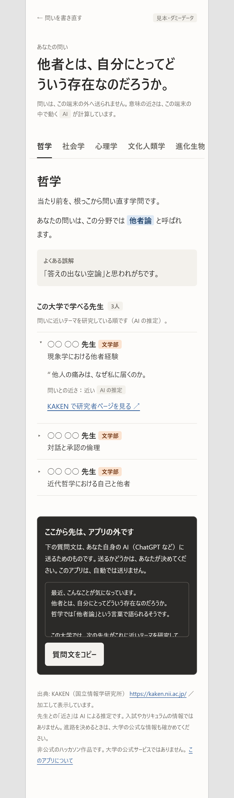
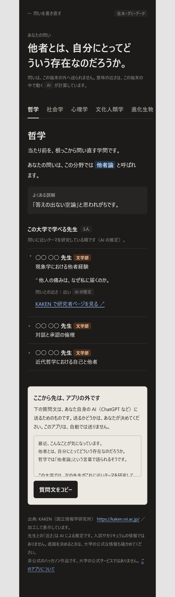
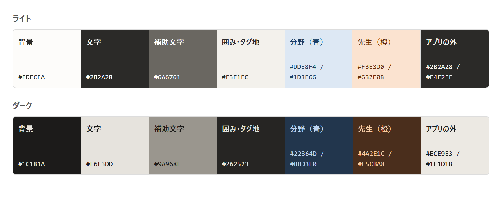

# 視覚デザインの方針

画面の見た目の方針と、その理由。**たたき台**（チームの合意はまだ）。見本は[ブラウザで開ける HTML](design/mock-result.html)（スマートフォン幅で見る。先生は「○○」のダミー）。仕様は [SPEC.md](SPEC.md)。

<table>
<tr>
<td align="center"><b>ライト</b> </td>
<td align="center"><b>ダーク</b> </td>
</tr>
</table>

## 結論

- **文書のように読ませる。** 題名は利用者の問い。分野はタブ、先生は折りたたみ。枠つきカードは並べない（Notion や Craft の考え方を参考にした）。
- **色は小さなタグだけ。** 分野は青、先生は橙。あとは中立色の文字と余白。
- **信頼感は構造から作る。** 一貫したルール、同じ位置の出典、近さの段階表示、「AI の推定」の明示。
- **熱は先生自身の言葉で出す。** 演出では出さない。
- **AI は色でなく小さな「AI」タグで示す。** アプリの外の画面は、背景を反転して別物に見せる。

## 1. 対象と目的

| 対象 | 状況 | 見たいもの |
| --- | --- | --- |
| 大学生（1〜2 年・配属前） | 何を学ぶか決める前で、分野名の壁がある | 近い分野と、この大学で会える先生 |
| 進路に悩む高校生 | 学部選びの途中。専門用語は大学生以上に遠い | 近い分野と、**学べる学部・先生** |

**二つは同格。** 共通点は「専門用語の壁の前に立っている」こと。画面は一つで、次を両方に通じるようにする。

- 専門用語は必ず一言の説明つきで出す。言葉づかいをやさしくする。
- **所属学部を先生の名前と同じ高さで見せる**（高校生は学部で選ぶ）。
- 「先生に会う」ではなく「**この大学で学べる先生**」と書く。
- 進路の判断材料になりうるので、「推定」「入試やカリキュラムの情報ではない」を目立つ位置に置く。
- 求める印象: わくわく・好奇心。先生からもらう熱、憧れ、学問の広い世界。そのうえで信頼感がある。

## 2. 色と文字

| 役割 | 使いどころ |
| --- | --- |
| 青（分野） | 分野まわりのタグ。「他者論」のような呼び名のハイライト、「隣の分野」の印 |
| 橙（先生） | 先生の所属学部のタグ |
| 反転（アプリの外） | 自分の AI に渡す画面。背景と文字の明暗を逆にして、アプリ内と区別する |
| 補助文字・囲み | 「AI」「推定」のタグ、よくある誤解の囲み、出典・注意書き |

**読みやすさ**（コントラスト比。小さな文字の目安は 4.5 以上）

| | 文字 | 補助文字 | 青タグ | 橙タグ | リンク | アプリの外 |
| --- | --- | --- | --- | --- | --- | --- |
| ライト | 14.0 | 5.0〜5.5 | 8.7 | 8.4 | 6.5 | 12.8 |
| ダーク | 13.4 | 5.8 | 8.0 | 8.2 | 8.1 | 13.9 |

**文字:** システムフォントのみ（Web フォントを読み込まない）。本文 16px・行間 1.85。題名は 27〜38px（画面幅に追従）。補助は 13px。タップできるものは 44px 以上。

## 3. 画面の構成

| 要素 | 内容 | 根拠 |
| --- | --- | --- |
| 題名 | 利用者の問いを大きく残す。直下に「問いは端末の外へ送られない」と、AI が端末内で動くこと | F-3, F-15 |
| タブ | 近い分野 5 つ。スワイプでも切り替え。次のタブが端でのぞく。「隣の分野」に印 | F-5, F-6 |
| 分野の本文 | ひとこと、「あなたの問いは、この分野では○○と呼ばれます」、よくある誤解（囲み） | F-7 |
| 先生 | 折りたたみ。見出しに名前・学部・研究テーマ。開くと引用・近さ（段階）・「AI の推定」・KAKEN へのリンク | F-9, F-10 |
| アプリの外 | 反転した囲み。「ここから先は、アプリの外」。質問文のプレビューとコピー | F-12〜F-16 |
| フッター | 出典（KAKEN）と加工の旨、近さは推定、入試等の情報ではない、非公式の明記 | 5 章 |

## 4. 原則

1. **問いが主役。** 結果画面でも、利用者の問いを題名として残す。
2. **世界は青、人は橙。**
3. **項目の羅列より文章。** ラベルと値を並べると、仕様書やフォームの見た目になる。
4. **近さは数字でなく段階で。** 精密な数字は偽の確からしさを与える。
5. **動きは最小。** 折りたたみの矢印程度。`prefers-reduced-motion` を尊重する。
6. **色だけで意味を伝えない。** タグには必ず文字がある。

**避けること:** 煽る文句と絵文字の多用／紫のグラデーションなど AI アプリの定番の演出／枠つきカードの入れ子／**大学の公式サイトに見えるデザイン**（ロゴ・校章は使わない）／Notion・Craft の素材（色・アイコン・ロゴ）の流用。

## 5. 選んだ理由

| 論点 | 決めたこと | 理由 |
| --- | --- | --- |
| 星のモチーフ | 採用しない | 名前は仮で思い入れがなく、スマートフォンで読みにくくなる |
| チャット風 | 採用しない | ChatGPT と混同する（F-16 に反する） |
| 求める質 | デザインとしての信頼感 | 熱と信頼は引っ張り合うので、土台＝信頼、差し色＝熱と役割を分けた |
| 最初の見本 | 作り直した | 枠つきカード＋チップ＋定番の配色で「超 AI っぽい」と評価された。「信頼＝中立で一貫」と読んだため、定番に収束した |
| 参考 | Notion・Craft | 河合の提示。文書の見た目で、大学生になじみがあり、信頼感につながる。先生を折りたたみにすると列の長さの問題も解けた |
| フォント | システムフォント | 読み込みがなく軽い。初回 120MB の予算も節約できる |

**学び:** 言葉だけで方向を決めると、定番に収束して作り直しになる。好みは**参考例**のほうが早く伝わる。

## 6. 未確認・課題

- **おとなしすぎる懸念。** 5 秒で売る 1 枚としては弱いかもしれない。企画のフックが画面に出ていない。
- **「熱」が薄い。** 先生の発言が折りたたみの中にある。引用してよい項目を、実データで確かめる（[KAKEN_API.md](KAKEN_API.md) と利用規約を参照）。
- **実機で未確認。** スワイプの感触、日本語のフォント表示（OS で変わる）。
- **仲間以外の人（特に高校生）に見せていない。** 根拠は河合の感想だけ。
- 読み込み中・エラー・空の状態は未設計。

## 7. SPEC への反映

SPEC.md に反映済み（ほかに、4.6 伝え方の F-17〜F-19 を追加）。変更した主な箇所は次のとおり。

| 箇所 | 変更前の SPEC | 見本・変更後 |
| --- | --- | --- |
| 対象ユーザー | 大学生 | 大学生と、進路に悩む高校生（同格） |
| 3 章 結果画面 | 分野の列、横スワイプ | タブ切り替え（スワイプも可） |
| F-9 | 先生を最大 3 人表示 | 折りたたみ。見出しは常に見える |
| F-10 | 所属を表示 | 所属学部を名前と同じ高さで見せる |
| 4.4 テンプレート | 「私の大学では」 | 「この大学では」 |

## 8. 次の一歩

1. 実機（iOS と Android）で見本を開く。
2. **仲間以外の人**に見せ、第一印象を聞く（高校生・大学 1〜2 年生が望ましい）。
   1. 何をするアプリだと思ったか。
   2. その大学の先生や学部を調べてみたいと思ったか。
   3. 信頼できそうか、何が引っかかったか。
3. 「5 秒で売る 1 枚」（結果画面の上部の見せ方）を決める。参考例を先にもらう。
4. ~~Next.js 実装では、見本の色を CSS 変数にする。~~ 実装済み（「9. 実装」）。

## 9. 実装

見た目の値は、画面の中に直接書かず、次の 2 か所のトークンだけを使う。

| ファイル | 持っているもの |
| --- | --- |
| `app/globals.css` | 色（`--ui-*`）。ライト・ダークの切り替え（`prefers-color-scheme`）もここ |
| `app/ui.css` | 文字・余白・角丸の目盛りと、部品のスタイル（`.ui-*`） |

**目盛り**（新しい値を足す前に、まず既存から選ぶ）

| 種類 | 値 |
| --- | --- |
| 文字 | `--fs-label` 13px、`--fs-body` 16px、`--fs-lead` 18px、`--fs-title` 26〜34px（画面幅に追従） |
| 余白 | `--sp-1`〜`--sp-16`（4 / 8 / 12 / 16 / 24 / 32 / 48 / 64px）。ページの上は 24px、下は 64px を空ける |
| 角丸 | `--r-sm` 6px、`--r-md` 10px |
| タップ | `--tap` 44px 以上。主なボタンは 48px |

**部品**

| 部品 | 場所 | 役目 |
| --- | --- | --- |
| `PageShell` | `app/components/PageShell.tsx` | 戻るリンク・小ラベル・題名・「非公式」の注記を持つ外枠 |
| `DeepenPanel` | `app/components/DeepenPanel.tsx` | 「深める」。質問文の全文表示とコピー。結果画面からは `question` / `field` / `term` / `teachers` を渡して置く |
| `buildPrompt` | `lib/prompt.ts` | SPEC 4.4 のテンプレートに値を差し込む（外へは送らない） |

**確認用のページ**（結果画面ができるまでの暫定）: `/deepen`（ダミー値で「深める」）、`/about`（このアプリについて）。

**決めたこと**

- 読む文章は **すべて 16px 以上**（SPEC 5 章）。13px は、タグ・小ラベル・番号の飾りだけに使う。この例外はたたき台で、チームの合意はまだ（SPEC 9 章の未決事項）。
- コピーボタンは、質問文の面の **右上のバー**（コードブロックの形）に置く。枠の入れ子にしない。押すと「コピーしました」に変わる。失敗したときだけ、メッセージを下に出す。
- 質問文は **全文を表示する**。箱の中のスクロールは、スマートフォンで指が引っかかるので使わない。
- 「アプリの外」は反転色と、外へ出る矢印つきのタグで示す。
- 文節で改行する（`word-break: auto-phrase`）。対応していないブラウザでは、ふつうの折り返しになる。

**確認したこと**: スマートフォン幅（526px）と PC 幅（1280px）、ダークとライト（ライトは色変数を上書きして確認）。横スクロールなし。**未確認**: iOS Safari・Android Chrome の実機、画面の読み上げ（スクリーンリーダー）。
